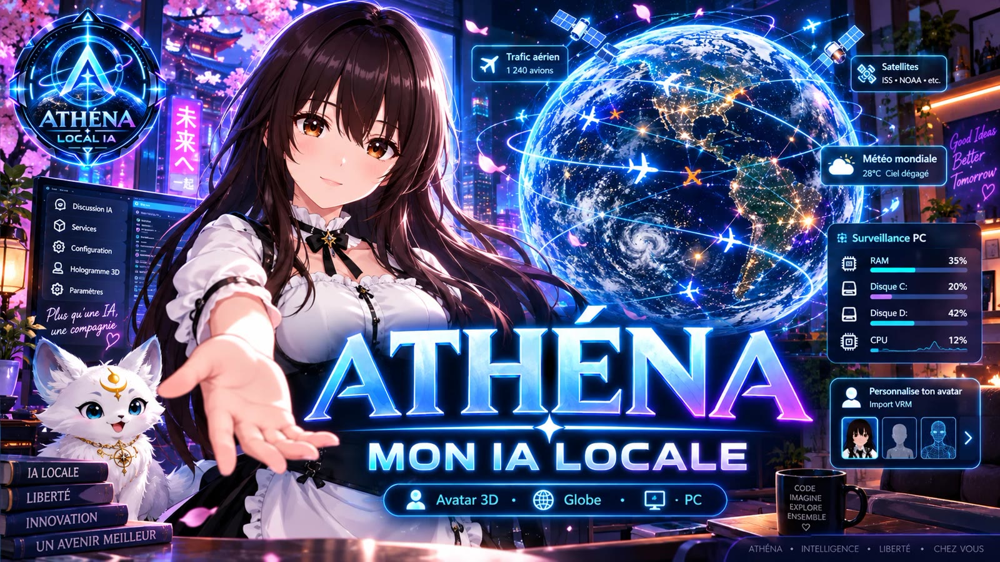

# Athéna Local IA — édition gratuite (alpha)

Une assistante IA qui tourne **sur votre PC** : la conversation, la mémoire, la voix et l'avatar 3D.
Vos conversations et vos fichiers ne quittent pas votre ordinateur, et chaque réponse dit
d'où elle vient : mesurée, tirée d'une source, appuyée sur sa mémoire, ou écrite par le modèle seul.

Présentation, vidéo et formulaire de retour : **https://athena-ia-locale.com**

Aide et retours : le serveur Discord d'ID Studio IA, **https://discord.gg/NquWmqwH6c**
(salons #aide-installation et #retours-alpha).

> **Version alpha.** Elle fonctionne, mais elle n'a été essayée que sur quelques PC.
> Vos retours servent à la corriger : la carte graphique, ce qui n'a pas marché, et surtout
> la phrase exacte qu'Athéna n'a pas comprise. Formulaire sur le site, section « Votre retour »,
> ou salon #retours-alpha sur Discord.

## Télécharger

Dans **[Releases](../../releases)**, prenez `Athena-gratuite-alpha.zip` (1,5 Go).
Son empreinte SHA-256 est indiquée avec la version : vous pouvez vérifier votre fichier avec
`Get-FileHash Athena-gratuite-alpha.zip` dans PowerShell.

## Il faut

- Windows 10 ou 11 (64 bits)
- une carte graphique d'au moins **8 Go de mémoire vidéo** (NVIDIA ou AMD)
- environ **20 Go libres**
- Internet pendant l'installation seulement

## Installer

1. Décompressez le fichier (clic droit → « Extraire tout »). Cela prend une dizaine de minutes.
2. Ouvrez le dossier `Athena` et double-cliquez sur **INSTALLER.bat**. Il télécharge ce qui manque,
   chez les éditeurs officiels et aux versions avec lesquelles Athéna est testée, et vérifie
   l'empreinte de chaque installateur avant de le lancer :
   - Node.js 22.23.3 (nodejs.org)
   - Ollama 0.35.0 (github.com/ollama)
   - les modèles `granite4.2:8b` (conversation) et `ornith-1.5:9b` (images), environ 12 Go, via Ollama
3. Double-cliquez sur le raccourci **Athéna** posé sur le Bureau.

Windows peut afficher « Windows a protégé votre ordinateur » ou « Éditeur inconnu » : les fichiers
`.bat` ne sont pas signés par un certificat payant. Vous pouvez les ouvrir avec le Bloc-notes pour
lire tout ce qu'ils font. Le détail est dans `LISEZ-MOI.txt`, à l'intérieur du dossier.

Désactivez la mise à jour automatique d'Ollama : la version 0.40 renomme les modèles qui lisent
les images et peut en rendre certains illisibles.

## Ce qui va sur Internet

Après l'installation, rien, sauf ce que vous activez vous-même : la météo de l'horloge,
le direct du globe, ou une clé Hugging Face.

## Crédits et licences

Animations de l'avatar : Mixamo (Adobe) ; pose de repos de secours : projet AIRI (MIT) ;
voix Pocket TTS par Kyutai (CC-BY 4.0), avec Python (PSF) et PyTorch (BSD) embarqués ; voix Piper : jeux SIWIS (CC-BY 4.0),
LJ Speech (domaine public), davefx (CC0) ; carte de la Terre : NASA (domaine public) ;
espeak-ng (GPL-3.0, programme séparé) ; fiches de culture générale tirées de Wikipédia
(CC BY-SA, source dans chaque fiche) ; modèles d'IA téléchargés chez leurs éditeurs, sous leur
propre licence (granite4.2 : Apache 2.0 ; ornith-1.5 : MIT). La liste complète est dans
`LICENCES.txt`, à l'intérieur du dossier.

Athéna est une création d'**ID Studio**. Ce dépôt sert seulement à distribuer l'édition gratuite.

---

**English.** Athéna Local IA is a local AI assistant for Windows (alpha). Download
`Athena-gratuite-alpha.zip` from Releases, unzip it, and run `INSTALLER.bat`: it fetches
Node.js 22.23.3, Ollama 0.35.0 and two models (about 12 GB) from their official sources and checks
each installer's SHA-256. Needs Windows 10/11, a GPU with 8 GB of video memory and about 20 GB of
free space. Feedback form: https://athena-ia-locale.com · Help and feedback on Discord:
https://discord.gg/NquWmqwH6c
