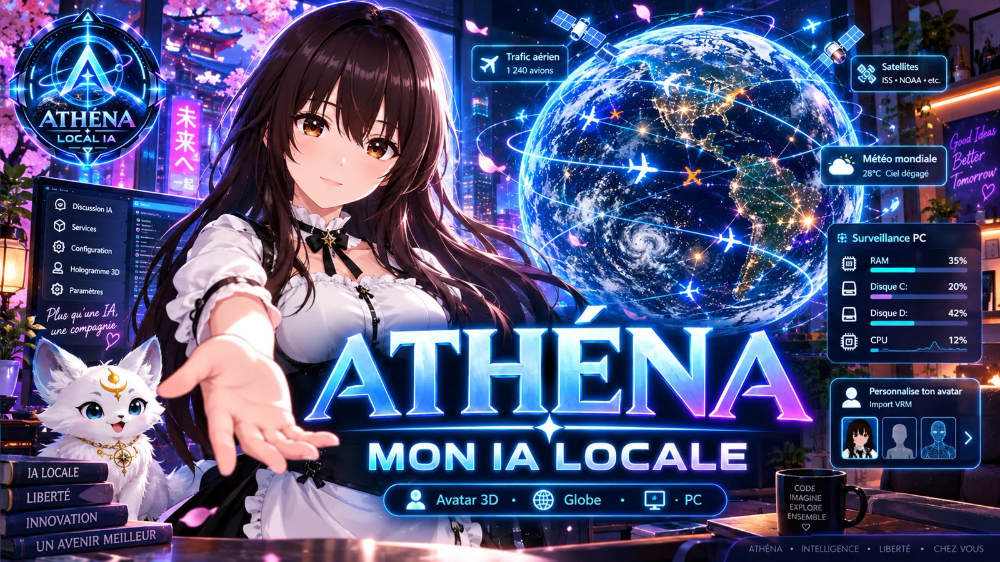
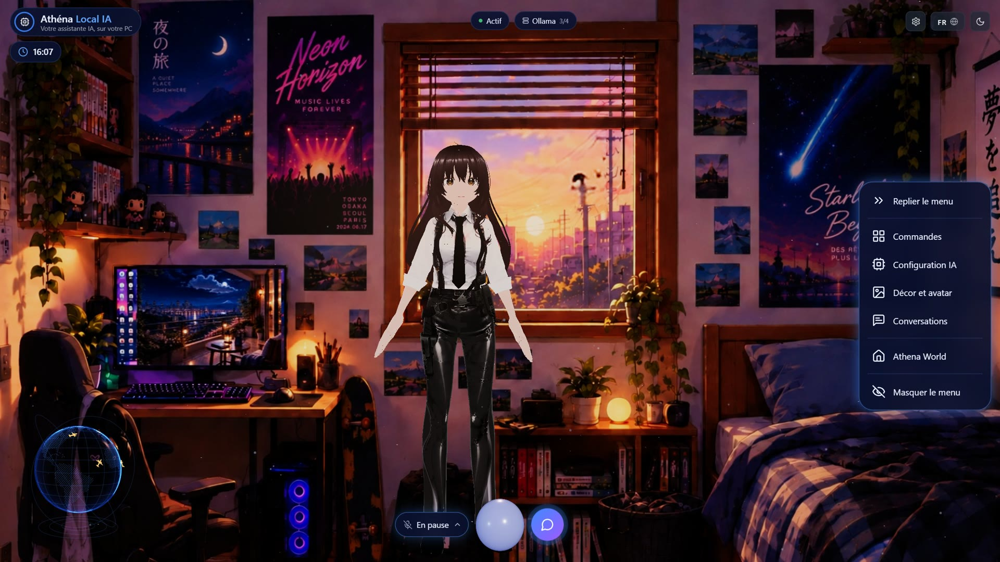
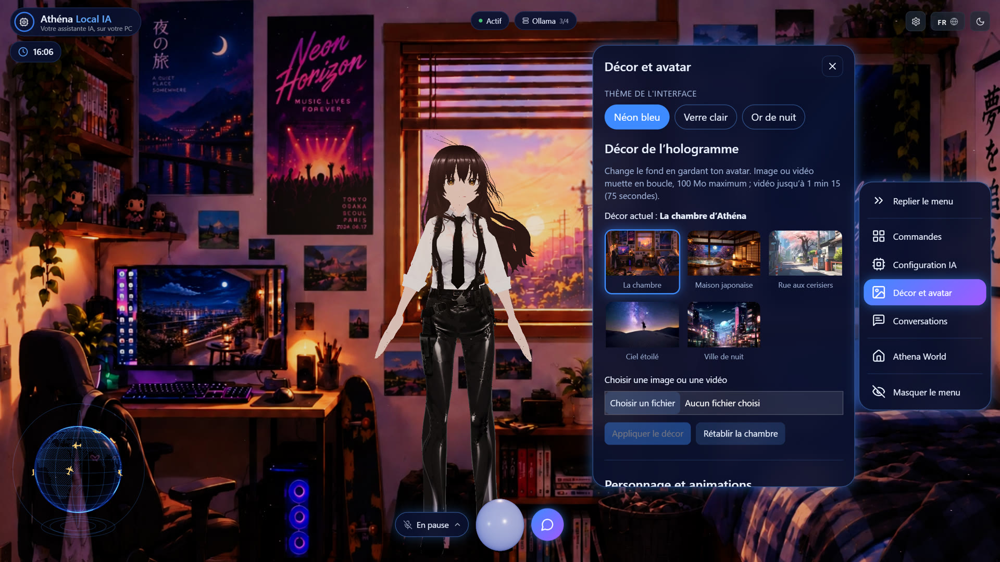

<h1 align="center">Athéna Local IA</h1>

<b>Une assistante IA qui tourne sur votre PC.</b> 
Conversation, mémoire, voix et avatar 3D, sans que vos conversations quittent votre ordinateur.

  
  
  
  
  

  <a href="../../releases/latest"><b>Télécharger l'édition gratuite</b></a> ·
  <a href="https://athena-ia-locale.com">Site et vidéo</a> ·
  <a href="https://discord.gg/NquWmqwH6c">Aide sur Discord</a> ·
  <a href="#english">English</a>

> **Version alpha.** Elle fonctionne, mais elle n'a été essayée que sur quelques PC. Vos retours servent
> à la corriger : votre carte graphique, ce qui n'a pas marché, et surtout la phrase exacte qu'Athéna n'a
> pas comprise.

## Sommaire

- [Ce qui la distingue](#ce-qui-la-distingue)
- [Ce qu'elle sait faire](#ce-quelle-sait-faire)
- [Captures](#captures)
- [Nouveau dans la 0.1.10](#nouveau-dans-la-0110)
- [Il faut](#il-faut)
- [Installer](#installer)
- [Ce qui va sur Internet](#ce-qui-va-sur-internet)
- [Questions fréquentes](#questions-fréquentes)
- [Contribuer](#contribuer)
- [Contributeurs](#contributeurs)
- [Remerciements et licences](#remerciements-et-licences)

## Ce qui la distingue

**Ce qui se mesure ne se génère pas.** L'heure, la date, la météo, l'état du PC, le contenu de sa mémoire :
Athéna les relève avec du code avant de laisser parler le modèle de langage. Chaque réponse dit d'où elle
vient : **mesurée**, tirée d'une **source**, appuyée sur sa **mémoire**, ou écrite par le **modèle seul**.

| Mesuré le 22/10/2026, même modèle, même vitesse | Athéna | Le modèle seul (LM Studio) |
|---|:---:|:---:|
| L'heure, la date, la météo et l'état du PC | **21 sur 21** | 0 sur 21 : il dit qu'il ne peut pas savoir |

- Un bilan de santé du PC en **0,06 seconde**.
- Une réponse vérifiée en **moins d'une seconde** ; le texte s'écrit à **30 à 40 mots par seconde** sur une
  carte graphique de jeu.

## Ce qu'elle sait faire

| | |
|---|---|
| **Conversation et mémoire** | Elle se souvient de vous d'une conversation à l'autre. Elle retrouve un souvenir par le sens, pas seulement par les mots. Tout reste dans votre PC. |
| **Voir sa mémoire** | La Vue cerveau dessine ce qu'elle garde, et l'Organisation des tâches montre les étapes de vos dernières demandes. *Nouveau dans la 0.1.10.* |
| **Veille du PC et sécurité** | État de la machine, Windows Defender et menaces détectées, logiciels de prise à distance en marche, plantages : elle dit ce qui ne va pas et quoi faire. Elle lit, elle ne modifie rien. |
| **Recherche avec sources** | Elle cite chaque source avec son lien : Wikipédia (français et anglais), publications scientifiques (OpenAlex, arXiv). |
| **Voix et micro** | Elle parle avec une voix calculée sur votre PC (Pocket TTS : « estelle », « anna », « alba »), et vous pouvez lui parler au micro. |
| **Lire les images** | Montrez-lui une image : un second modèle, local lui aussi, la décrit. |
| **Avatar 3D et décors** | Un avatar animé, 5 décors, ou votre propre image ou vidéo en fond ; 3 thèmes d'interface (Néon bleu, Verre clair, Or de nuit) et un globe. |
| **Langues** | Interface en français, anglais, espagnol et darija. |
| **Modèles au choix** | Une liste de modèles conseillés, avec leur taille, leur licence et la carte qu'il leur faut. On en change sans rien réinstaller, et la mémoire reste. |

## Captures

Captures de l'application réelle.

## Nouveau dans la 0.1.10

- **Vue cerveau** : la mémoire d'Athéna dessinée en anneaux. Seuls les niveaux qu'elle mesure vraiment sont
  dessinés : les conversations, les souvenirs et ses spécialistes.
- **Vue simple** : les mêmes souvenirs en cartes, rangés en « Mémoires » et « Tâches ». L'ancienne carte
  reste sous « Carte d'origine ».
- **Organisation des tâches** : les étapes de vos dernières demandes et le temps de chacune. Le journal qui
  la nourrit reste sur votre PC et ne garde ni la question ni la réponse.

Pour l'ouvrir : dans la petite fenêtre de l'état du PC, bouton « Mémoire — explorer les liens ».
Toutes les versions et leurs notes : **[Releases](../../releases)**.

## Il faut

| | Minimum | Conseillé |
|---|---|---|
| Système | Windows 10 ou 11, 64 bits | Windows 11 |
| Carte graphique | 8 Go de mémoire vidéo (NVIDIA ou AMD) | 10 Go ou plus |
| Mémoire vive | 8 Go | 16 Go |
| Disque | environ 20 Go libres | |
| Internet | pendant l'installation seulement | |

Avec moins de 10 Go de mémoire vidéo, l'installation choisit Granite 4.2 · 3B, qui tient en entier dans la
carte (mesuré sur une GTX 1080 de 8 Go : 6,6 s par réponse, contre 31 s pour le 8B).

## Installer

1. Dans **[Releases](../../releases/latest)**, prenez `Athena-gratuite-alpha.zip` (1,5 Go). Son empreinte
   SHA-256 est indiquée avec la version ; vérifiez-la avec `Get-FileHash Athena-gratuite-alpha.zip` dans
   PowerShell.
2. Décompressez-le (clic droit → « Extraire tout ») : une dizaine de minutes.
3. Ouvrez le dossier `Athena` et double-cliquez sur **INSTALLER.bat**. Une fenêtre montre chaque étape. Il
   télécharge ce qui manque chez les éditeurs officiels, aux versions avec lesquelles Athéna est testée, et
   vérifie l'empreinte de chaque installateur avant de le lancer :
   - Node.js 22.23.3 (nodejs.org) ;
   - Ollama 0.35.0 (github.com/ollama) ;
   - deux modèles, choisis selon votre carte : Granite 4.2 · 8B (5,3 Go) ou · 3B (2,2 Go) pour la
     conversation, et ornith-1.5:9b (6,6 Go) pour lire les images.
4. Double-cliquez sur le raccourci **Athéna** posé sur le Bureau. Le premier démarrage prend environ une
   minute.

Si la connexion coupe, relancez INSTALLER.bat : ce qui est déjà téléchargé est gardé. Le détail est dans
`LISEZ-MOI.txt`, à l'intérieur du dossier.

## Ce qui va sur Internet

Après l'installation, la conversation, la mémoire et vos fichiers restent sur votre PC. Ce qui sort, seulement
quand vous le demandez ou l'activez :

- la recherche avec sources (Wikipédia, OpenAlex, arXiv) ;
- la météo de l'horloge, éteinte au départ ;
- le direct du globe ;
- une clé Hugging Face, si vous en mettez une ;
- la voix gratuite de Google, en secours, si la voix locale n'est pas disponible pour une langue ;
- les vidéos YouTube et le cours d'une crypto-monnaie, quand vous les demandez.

La liste de chaque service, avec son rôle, est dans [Contributeurs](#les-services-en-ligne-quathéna-utilise).

## Questions fréquentes

<b>Windows affiche « Windows a protégé votre ordinateur »</b>

Ce n'est pas une erreur : les fichiers `.bat` d'Athéna ne sont pas signés par un certificat payant. Cliquez
sur « Informations complémentaires », puis sur « Exécuter quand même ». Vous pouvez ouvrir INSTALLER.bat avec
le Bloc-notes pour lire tout ce qu'il fait.

<b>Mon antivirus se méfie du fichier</b>

Un programme récent et peu téléchargé déclenche souvent cette méfiance. Comparez l'empreinte SHA-256 du zip
avec celle de la version : si elles sont identiques, c'est bien le fichier publié ici.

<b>Faut-il laisser Ollama se mettre à jour ?</b>

Non. L'installation coupe sa mise à jour automatique : la version 0.40 renomme les modèles qui lisent les
images et peut en rendre certains illisibles. Si elle n'y arrive pas, elle vous dit comment le faire.

<b>Quand j'envoie une image, la réponse met quelques secondes de plus</b>

C'est normal avec 8 Go de mémoire vidéo : les deux modèles n'y tiennent pas ensemble, Ollama les échange.

<b>La première phrase parlée tarde</b>

Sur un processeur ancien, la voix Pocket peut tarder un peu. Dans le chat : « Réglages de la voix » →
« Moteur de voix » → Piper, plus rapide.

<b>Comment tout arrêter ?</b>

Double-cliquez sur « Arrêter Athéna.bat », dans le dossier. Sa mémoire est gardée. Pour effacer vos données :
⚙️ en haut à droite → vos données → exporter ou tout effacer.

## Contribuer

L'alpha avance grâce à ceux qui l'essaient. Pour aider :

- **Essayez-la sur votre PC** et dites-nous votre carte graphique, votre processeur et le temps de la
  première réponse.
- **Signalez ce qu'elle n'a pas compris**, avec la phrase exacte que vous avez tapée ou dite : c'est ce qui
  nous permet de la corriger. Par une [issue](../../issues), le salon #retours-alpha sur
  [Discord](https://discord.gg/NquWmqwH6c), ou le formulaire du [site](https://athena-ia-locale.com).
- **Joignez une capture** de tout message d'erreur.
- **Parlez-en** autour de vous, et ajoutez une ⭐ au dépôt si le projet vous plaît.

## Contributeurs

Athéna est développée par **ID Studio IA, un studio indépendant**. Merci à toutes les personnes qui ont essayé
l'alpha et envoyé leurs retours : chaque phrase signalée a servi.

| Qui | Rôle |
|---|---|
| **ID Studio IA** | conception, choix, essais réels sur PC, décisions |
| **[Claude Code](https://claude.com/claude-code)** (Anthropic) | assistant de programmation : écriture du code, tests, bancs de mesure, préparation des versions |
| **Les testeurs de l'alpha** | retours, phrases signalées, essais sur d'autres cartes graphiques |

### Les services en ligne qu'Athéna utilise

Athéna ne dépend d'aucun service payant et ne demande aucun compte. Ces services publics ne sont appelés que
lorsque vous demandez ce qu'ils fournissent, ou que vous activez la fonction. Merci à eux :

| Pour quoi | Service |
|---|---|
| Savoir et vérification des réponses | [Wikipédia](https://fr.wikipedia.org) (français et anglais) |
| Publications scientifiques | [OpenAlex](https://openalex.org), [arXiv](https://arxiv.org) |
| Météo, recherche de ville, qualité de l'air | [Open-Meteo](https://open-meteo.com) |
| Globe : images de la Terre | [NASA GIBS](https://earthdata.nasa.gov/gibs) |
| Globe : séismes | [USGS](https://earthquake.usgs.gov) |
| Globe : catastrophes, tsunamis, tornades | [GDACS](https://www.gdacs.org), [NOAA tsunami.gov](https://www.tsunami.gov), [NWS weather.gov](https://www.weather.gov) |
| Globe : avions en vol | [OpenSky Network](https://opensky-network.org), [adsb.lol](https://adsb.lol) |
| Globe : satellites | [CelesTrak](https://celestrak.org) |
| Cours d'une crypto-monnaie, si vous le demandez | [CoinGecko](https://www.coingecko.com) |
| Voix locales et modèles | [Hugging Face](https://huggingface.co) (téléchargement des voix Piper), [Ollama](https://ollama.com) (modèles) |
| Voix de secours, si la voix locale manque pour une langue | Google Traduction |
| Vidéos et musique | [YouTube](https://www.youtube.com) (lecteur intégré) |

Autour du projet : [GitHub](https://github.com/idstudio-athena) pour les versions, [Netlify](https://www.netlify.com)
pour le [site](https://athena-ia-locale.com), [Discord](https://discord.gg/NquWmqwH6c) pour la communauté,
[Ko-fi](https://ko-fi.com/idstudioia) pour le soutien.

## Remerciements et licences

Athéna s'appuie sur des projets ouverts. Merci à leurs auteurs :

- **[Ollama](https://ollama.com)** fait tourner les modèles sur votre carte graphique ;
- **Granite 4.2** d'IBM (Apache 2.0) pour la conversation, **ornith-1.5** (MIT) pour les images ;
- **[Pocket TTS](https://github.com/kyutai-labs/pocket-tts)** par Kyutai (CC-BY 4.0) pour la voix, avec Python
  (PSF) et PyTorch (BSD) ; voix **Piper** : jeux SIWIS (CC-BY 4.0), LJ Speech (domaine public), davefx (CC0) ;
  espeak-ng (GPL-3.0, programme séparé) ;
- animations de l'avatar : **Mixamo** (Adobe) ; pose de repos de secours : **[projet AIRI](https://github.com/moeru-ai/airi)** (MIT) ;
- carte de la Terre : **NASA** (domaine public) ; fiches de culture générale tirées de **Wikipédia**
  (CC BY-SA, source dans chaque fiche) ; publications scientifiques par **OpenAlex** et **arXiv**.

La liste complète, avec chaque licence, est dans `LICENCES.txt`, à l'intérieur du dossier. Ce dépôt sert à
distribuer l'édition gratuite ; Athéna est une création d'**ID Studio**.

**Soutenir le projet** : [Ko-fi](https://ko-fi.com/idstudioia) · l'édition complète se prépare sur la
[page de la campagne](https://athena-ia-locale.com/campagne.html).

---

## English

**Athéna Local IA** is a local AI assistant for Windows (alpha): conversation, memory, voice and a 3D avatar,
running on your own PC. Before the language model speaks, Athéna measures what can be measured (time, date,
weather, PC state, her own memory), and every answer shows where it comes from.

- **Download** `Athena-gratuite-alpha.zip` from [Releases](../../releases/latest), unzip it, and run
  `INSTALLER.bat`. It fetches Node.js 22.23.3, Ollama 0.35.0 and two models from their official sources, and
  checks each installer's SHA-256.
- **Needs** Windows 10/11, a GPU with at least 8 GB of video memory (NVIDIA or AMD), 8 GB of RAM (16 GB
  recommended) and about 20 GB of free space.
- **New in 0.1.10**: a "brain view" of her memory, and a task view showing the steps of your last requests.
- **Made by** ID Studio IA, an independent studio, with [Claude Code](https://claude.com/claude-code)
  (Anthropic) as programming assistant. Online services, only when you ask: Wikipedia, OpenAlex, arXiv,
  Open-Meteo, NASA GIBS, USGS, GDACS, NOAA, NWS, OpenSky, adsb.lol, CelesTrak, CoinGecko, Hugging Face,
  Ollama, Google Translate (fallback voice), YouTube.
- **Help and feedback**: [Discord](https://discord.gg/NquWmqwH6c) · [issues](../../issues) ·
  [athena-ia-locale.com](https://athena-ia-locale.com)
